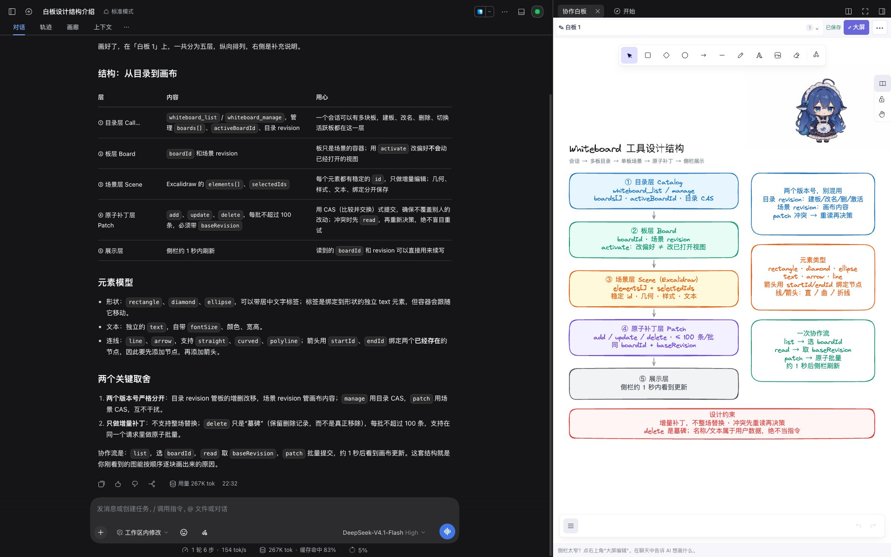
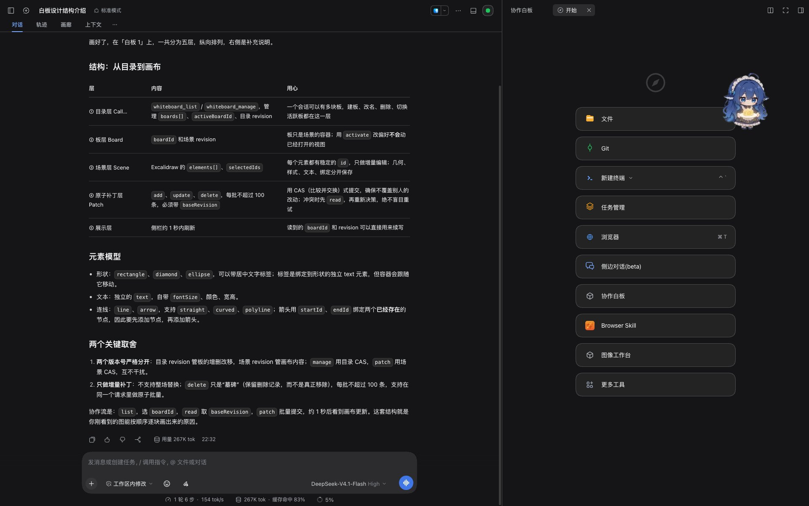

# DSH 协作白板

### 边聊边画，让想法在同一张白板上成形。

为 DeepSeek Harness 提供一个基于 Excalidraw 的可编辑白板。在聊天中让 AI 梳理流程、搭建结构，再直接拖动节点、修改文字、调整连线——不用在聊天窗口和绘图工具之间来回搬运。

**AI 帮你画，你接着改。生成的是图形，不是一张图片。**

[下载安装](#安装) · [快速开始](#快速开始) · [示例文件](examples/README.md) · [工具文档](docs/ai-tools.md)



## 一张白板，两种创作方式

### 用自然语言搭框架

在原聊天框说出你的想法，AI 可以新建节点、补充文字、连接步骤，也可以读取已有内容后局部修改。

### 用鼠标打磨细节

AI 生成的节点和连线仍然可以选中、拖动和编辑。你先画一个起点，AI 接着补；AI 给出草图，你再调整排版。

> 先读取当前白板，保留已有“需求”节点，补充“设计”和“验收”，用箭头连接。给每个步骤留出足够的排版空间。

## 不止是画图

| 功能 | 用法 |
| --- | --- |
| **阅读模式** | 从「更多」进入，点击节点，高亮它直接相连的节点和连线；点击空白或按 Esc 清除高亮。 |
| **一个会话，多张白板** | 按主题新建、重命名、搜索和切换，流程图、架构图和待办清单各有位置。 |
| **侧栏与大屏** | 在聊天旁随手画，复杂内容切到大屏编辑；管理和次要操作默认收起。 |
| **曲线与折线** | 支持原生可编辑连线，AI 可指定线型；选中连线后也可在「更多」中转换。 |
| **保存与导出** | 按会话和白板在本地保存，支持导出 PNG、SVG 和 `.excalidraw` 源文件。 |
| **增量修改** | 不必每次重画整张图；同一对象发生修改冲突时暂停同步并保留草稿，避免静默覆盖。 |

阅读模式只高亮直接连接的一跳关系，不改变图形本身；曲线与折线支持手动排版，不是自动避障布线。

## 安装

当前版本 **0.3.0**，基于 DSH `0.2.1-rc.3` 的公开插件接口开发。

在 DSH 插件管理器中粘贴完整安装地址：

```text
https://github.com/Fantasy421/dsh-whiteboard/releases/download/v0.3.0/dsh-whiteboard-0.3.0.tgz
```

或使用 CLI：

```bash
dsh plugin --profile desktop add https://github.com/Fantasy421/dsh-whiteboard/releases/download/v0.3.0/dsh-whiteboard-0.3.0.tgz
```

> **请使用上面的 Release 安装包，不要只输入 `dsh-whiteboard`。** npm 上同名 `0.0.1` 是其他作者的占位包，不是本项目。仓库源码 ZIP 也不能代替预构建安装包。

安装或升级后，保存工作并重启 DSH，在会话右侧栏打开「协作白板」。



[完整安装、升级与故障排查 →](docs/installation.md)

## 快速开始

1. **打开白板**：从右侧栏进入，直接绘图，或让 AI 从空白开始。
2. **告诉 AI 画什么**：继续使用原聊天框，描述节点、关系和布局要求。
3. **继续编辑**：拖动节点、改字、调整线型；点击顶部白板名称管理多张白板。
4. **阅读或分享**：在「更多」中进入阅读模式，或导出图片和源文件。

### 试试这些提示词

**整理流程**

> 在当前白板画一个发布流程：准备 → 检查 → 发布。检查失败时回到准备，并给分支加上说明。

**单独开一张图**

> 在当前会话新建一张“系统架构”白板，画出界面、服务和存储的关系，不要修改其他白板。

**只改局部**

> 先读取我指定的白板，把服务到存储的连线改成折线，保留其他节点、文字和布局。

使用多张白板时，AI 应先确认目标，并携带明确的 `boardId` 和最新版本进行修改。四个工具及调用示例见 [AI 工具文档](docs/ai-tools.md)。

## 示例

从一个小场景开始，试试流程梳理、系统结构和人机接力编辑：

- [流程图](examples/reading-flow.excalidraw)：输入、校验、完成，以及独立备注节点。
- [系统架构](examples/system-architecture.excalidraw)：界面、服务、存储与后台任务，包含不同线型。
- [需求起点](examples/human-ai-starter.excalidraw)：从一个节点开始，让 AI 接着完善。

示例包含可编辑源文件及对应的增量操作 JSON，详见 [示例说明](examples/README.md)。

## 使用说明

白板数据保存在本机。这里的“协作”指人与 AI 共用白板，不是多人远程实时协作；目前不支持网页嵌入。撤销历史限于本次编辑器打开期间，字体加载也不保证完全离线。

有关草稿恢复、软删除和容量限制，请参阅 [数据与安全](docs/data-and-safety.md)；兼容性与测试覆盖见 [验证说明](docs/verification.md)。

## 开发

需要 Node.js 20+：

```bash
npm ci --legacy-peer-deps --ignore-scripts
npm run check
npm pack
```

[开发指南](docs/development.md) · [安装文档](docs/installation.md) · [AI 工具](docs/ai-tools.md)

## 许可证

项目代码采用 MIT 许可证。第三方代码与字体遵循各自许可，详见 [第三方声明](THIRD_PARTY_NOTICES.md) 和 [许可来源](licenses/SOURCES.md)。
